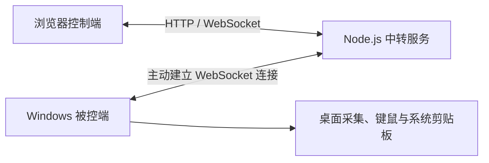

# ToLink

可自托管的浏览器远程桌面。Windows 被控端主动连接中转服务，控制端通过浏览器输入设备 ID 和密码访问桌面。

ToLink 适合远程办公、开发机访问及内部设备维护。当前处于测试阶段，本仓库包含 Windows 客户端、中转服务、网页控制端和 Linux 部署脚本；macOS 被控端源码尚未收录。

[快速开始](#快速开始) · [编译客户端](#编译-windows-客户端) · [项目结构](#项目结构) · [技术文档](#技术文档) · [贡献](#参与贡献)

## 功能

| 能力 | 说明 |
| --- | --- |
| 浏览器远程控制 | 鼠标、键盘、滚轮、全屏和撑满窗口 |
| 设备身份 | 首次注册分配固定 9 位 ID，每台设备设置独立访问密码 |
| 视频传输 | H.265 / H.264；硬编码不可用时回退 JPEG |
| 按需推流 | 无观看者时停止采集，画面静止时减少视频传输 |
| 文本粘贴 | Ctrl+V / ⌘V 传递文本，单次最多 1000 个 UTF-16 单元 |
| 文件粘贴 | Windows 原生复制窗口，边接收边写入目标文件夹，支持系统取消 |
| 多文件 | 每批最多 32 个普通文件、合计 100 MiB；不支持文件夹 |
| 锁屏与息屏 | 安装 Windows 辅助服务后显示锁屏画面、唤亮屏幕并转发键鼠 |
| 连接恢复 | 客户端自动重连，断开控制时释放按键 |
| 自托管 | Node.js 中转；Linux 部署脚本支持升级、配置保留和失败回滚 |

> 锁屏支持仍需通过 Windows 登录认证，不保存系统登录密码。不包含系统睡眠、休眠、关机或网络开机唤醒。

## 工作方式



- 被控端主动连接服务器，无需在被控电脑上开放入站端口。
- 中转按设备身份转发画面、控制消息和文件数据，不执行视频解码或编码。
- 浏览器使用设备 ID 和访问密码登录；同一设备同时只允许一个控制连接。
- Windows 使用 C# / WinForms / .NET Framework，GDI 采集画面，FFmpeg / Intel Quick Sync 编码，`SendInput` 注入键鼠。
- 原生文件粘贴通过虚拟文件剪贴板与 `IStream` 提供持续到达的数据，复制进度及重名处理交由 Windows 完成。
- 公网访问应在中转前配置 HTTPS / WSS 反向代理；图中的 HTTP / WebSocket 是开发环境默认方式。

## 项目结构

```text
to_link/
├── client/windows/        # C# 客户端、锁屏服务、编译入口及测试
├── server/                # Node.js 中转、鉴权和配置示例
│   ├── public/            # 浏览器控制页面
│   ├── test/              # 自动化回归
│   └── scripts/           # 压测与浏览器验证工具
├── deploy/linux/          # Linux 安装、管理、配置检查及运行时清单
├── scripts/               # 打包和开发环境辅助工具
├── docs/                  # 使用说明、设计及验证记录
├── dist/                  # 构建缓存、安装包、测试输出；不提交 Git
└── private/               # 本地配置与凭据；不提交 Git
```

`dist/` 和 `private/` 是本地目录，首次克隆时不一定存在。原目录映射见[结构调整记录](docs/repository-layout.md)。

## 环境要求

| 组件 | 要求 |
| --- | --- |
| 中转源码 | Node.js ≥ 18、npm |
| Windows 客户端 | Windows x64、.NET Framework 4.5+；已在 Windows 10 x64 验证 |
| 视频编码 | FFmpeg 提供 `h264_qsv` / `hevc_qsv`，且机器支持 Intel Quick Sync；也可使用 JPEG |
| 控制端 | 支持 WebSocket 的现代浏览器；视频模式还取决于浏览器 MSE 和对应解码能力 |
| Linux 离线安装包 | systemd、glibc ≥ 2.28、libstdc++；包含 x86_64 / ARM64 运行时 |

## 快速开始

### 1. 获取代码与依赖

```bash
git clone https://github.com/lang321/to_link.git
cd to_link
npm --prefix server ci --ignore-scripts
```

### 2. 初始化中转配置

以下命令在仓库根目录执行，适用于 Bash。它生成独立注册密钥；若配置已存在，会拒绝覆盖。

```bash
node <<'NODE'
const fs = require('node:fs');
const crypto = require('node:crypto');
const config = JSON.parse(fs.readFileSync('server/relay.example.json', 'utf8'));
config.enrollmentToken = crypto.randomBytes(32).toString('hex');
fs.mkdirSync('private', { recursive: true });
fs.writeFileSync('private/relay.json', JSON.stringify(config, null, 2), {
  flag: 'wx', mode: 0o600
});
NODE
npm --prefix server start
```

默认访问 `http://localhost:19000`。配置位于 `private/relay.json`，设备数据位于 `private/devices.json`。也可用 `TOLINK_CONFIG` 指定配置文件。

局域网跨机器连接时，修改以下配置后重启服务：

- `host`：改为 `0.0.0.0` 或服务器的监听地址。
- `origins`：加入浏览器实际访问的完整地址，例如 `http://192.0.2.10:19000`，不要包含路径或末尾 `/`。示例 IP 需换成自己的服务器地址。
- `stateFile`：指定可写的设备状态文件；相对路径以服务启动时的工作目录为基准。上述 npm 启动方式的工作目录为 `server/`。

注册密钥 `enrollmentToken` 仅用于新设备注册；浏览器登录使用每台设备的独立访问密码。

### 3. 编译 Windows 客户端

在 Windows 命令提示符中，从仓库根目录执行：

```bat
cd client\windows
build.cmd
copy /-Y agent.example.json agent.json
```

编辑 `agent.json`：

- `Server`：填写中转地址，例如 `ws://192.0.2.10:19000`，公网配置对应 `wss://`。
- `EnrollmentToken`：填写中转配置中的注册密钥。
- `AccessPassword`：可留空，由客户端生成；也可预设 8～128 个字符的设备密码。

然后运行 `ToLink.exe`，点击“保存并连接”。首次注册成功后，客户端显示设备 ID，并保存独立设备令牌。

`build.cmd` 生成普通多文件版本：配置和日志与 EXE 同目录。使用 H.264 / H.265 时，将相应 `ffmpeg.exe` 放在同目录；仅测试 JPEG 时不需要 FFmpeg。单文件发行版的配置位于 `%LOCALAPPDATA%\ToLink`，打包说明见 [scripts/README.md](scripts/README.md)。

### 4. 连接桌面

1. 浏览器打开中转地址，输入客户端显示的设备 ID 和访问密码。
2. 点击“启用控制”，在远程画面内操作。
3. 传文件前，先在远端资源管理器选中目标文件夹，再粘贴文件或点击“粘贴文件”选择。
4. 新版 Windows 客户端会显示系统原生复制窗口；数据尚未完整到达时，请保持浏览器连接。

浏览器未提供剪贴板文件内容时，需要通过文件选择器选择。关闭客户端窗口后仍保留托盘，托盘“退出”才结束客户端。

### 5. 可选：启用锁屏支持

在 `client\windows` 中运行 `安装锁屏支持.cmd`，使用运行 ToLink 的同一 Windows 账号接受管理员授权。

辅助服务负责安全桌面的采集和键鼠转发。浏览器点击“唤醒屏幕”后，通过系统登录界面完成认证。安装、卸载和已验证范围见[锁屏说明](docs/lock-screen.md)。

## Linux 部署与维护

生成的服务端包位于 `dist/releases/server/`。在目标 Linux 服务器解压后安装：

```bash
tar -xzf ToLink-Server-linux.tar.gz
cd tolink-server
sudo bash install.sh --public-url http://192.0.2.10:19000
sudo bash manage.sh status
sudo bash manage.sh info
```

用自己的服务器地址替换示例地址。`manage.sh info` 会显示新设备注册密钥，请只在受控终端查看。

| 路径 | 内容 |
| --- | --- |
| `/opt/tolink/releases/` | 服务程序版本，`current` 指向当前版本 |
| `/etc/tolink/relay.json` | 服务配置和注册密钥 |
| `/var/lib/tolink/devices.json` | 设备身份、令牌和密码哈希 |

升级时解压新包并重新执行安装脚本；默认保留配置与设备数据。不要让多个实例共享写入同一个设备状态文件。

公网部署需自行配置域名、证书及反向代理，覆盖网页、`/api/` 和 `/ws/` 路径。安装脚本不会自动申请证书或修改防火墙。详见 [Linux 部署说明](docs/linux-deployment.txt)。

## 开发与验证

```bash
npm --prefix server test
```

测试覆盖鉴权、设备隔离、连接恢复、坐标映射、剪贴板、文件批次、流式能力协商、唤醒及安装配置。Windows 相关测试位于 `client/windows/tests/`，需在 Windows 环境单独编译运行；具体工具见[开发脚本说明](scripts/README.md)。

当前限制：

- 不支持音频、文件夹传输、P2P 直连和系统睡眠唤醒。
- 硬编码已验证 Intel Quick Sync 路径；其他显卡未完成验收。
- 多屏真实场景和强制 Ctrl+Alt+Del 登录策略尚未完整验收。
- 模拟多设备转发结果不等同于百台真实桌面的性能保证。
- 当前设备状态由单个中转进程维护，不支持多实例共享状态文件。

## 技术文档

- [原生流式文件粘贴](docs/file-transfer.md)
- [锁屏与息屏唤醒](docs/lock-screen.md)
- [剪贴板与服务器设置](docs/clipboard-and-settings.md)
- [性能设计](docs/performance.md)
- [验证记录](docs/validation.md)
- [Linux 安装包设计](docs/server-deployment.md)
- [开发历史](docs/development-history.md)

历史记录可能包含旧目录和测试环境信息，当前使用方式以本页及脚本说明为准。

## 参与贡献

欢迎通过 Issue 反馈问题或提交 Pull Request。

- 问题描述请包含操作系统、客户端／服务端版本、复现步骤和经过脱敏的日志。
- 修改涉及行为时，补充对应验证；提交前运行 `npm --prefix server test`。
- Windows 采集、键鼠、剪贴板和锁屏改动，应附实机验证结果。
- 不提交设备配置、注册密钥、访问密码、日志、依赖目录或编译产物。

## 发布状态与许可证

当前仓库尚未添加项目级 `LICENSE`，授权条款待维护者确定；本文不声明 MIT、Apache-2.0 等许可。

现有历史测试 EXE 内嵌默认服务器和注册配置，已移入被 Git 忽略的 `dist/`，不作为通用公开发行包。**Git 历史仍可能保留这些旧产物**；公开发布前应处理相关注册凭据和历史产物，并使用发布配置重新构建。

Node.js、`ws` 和 FFmpeg 的第三方许可证以所用发行版及其随附声明为准。重新分发时，应保留相应许可证与来源信息。
